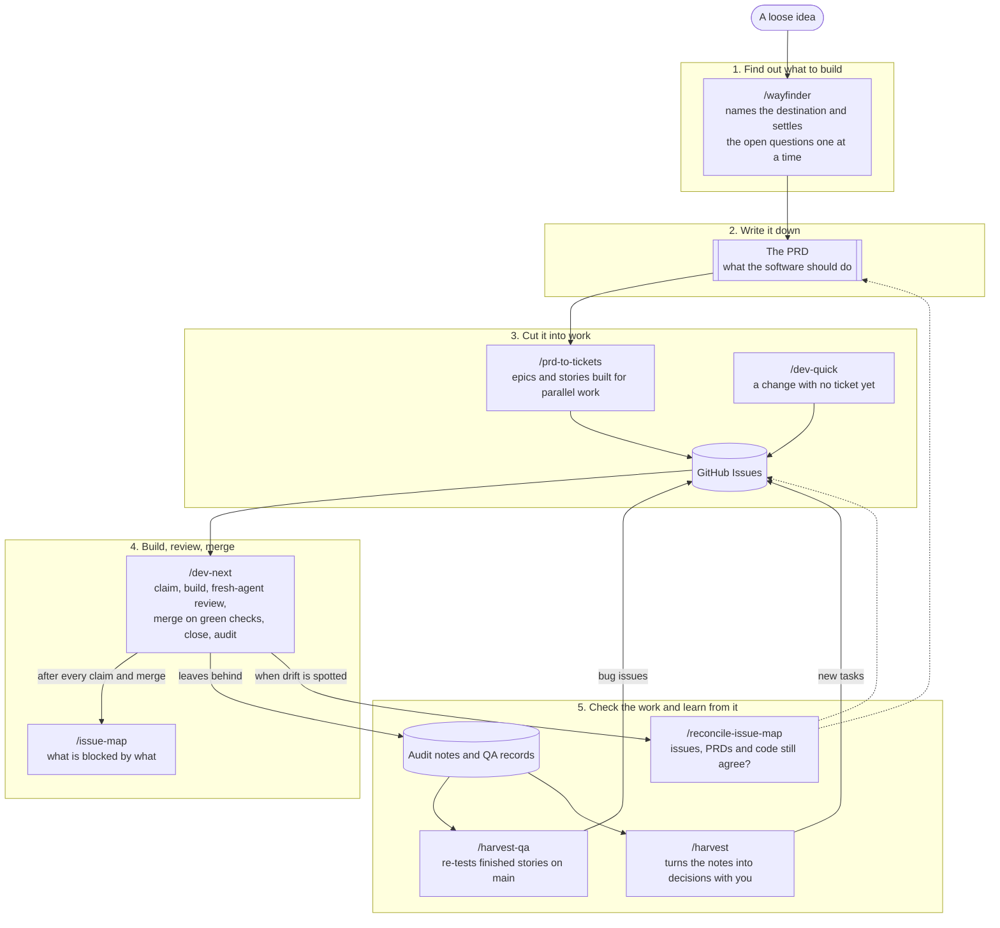

<p align="center">
  
</p>

# orion

> [!CAUTION]
> orion tells an AI assistant how to work in your project, and the assistant will run commands and edit files on your machine. Review what you install, keep your work saved, and use it at your own risk. It is under constant improvement and is provided as-is.

**orion is a framework you install into your own project** to help you build software better and faster with [Claude Code](https://claude.com/claude-code), Anthropic's AI coding assistant.

Once installed, it lives inside the project itself, so there is nothing for teammates to set up: whoever clones the project gets orion with it, and improvements arrive with a normal update.

## What you get

- **Skills** – ready-made abilities for the everyday tasks of a software project, which the assistant can run on request.
- **Working rules** – a set of mandatory good practices your project's own instructions file (`CLAUDE.md`) imports, so the assistant works the same careful way for everyone on the team. Your `CLAUDE.md` holds the facts that are specific to your project and stays yours.
- **A status bar** (optional, per computer) – a one-line display at the bottom of the assistant that shows useful live information such as time, cost and usage while you work.

## How the skills fit together

orion's skills are built around one way of working, from a first idea to finished, checked software. You do not have to use all of them, but they are designed to hand over to each other:

1. **Find out what to build.** `/wayfinder` takes a loose idea, names the destination it is heading for and turns every open question into a small decision ticket. It settles them one at a time until the way is clear.
2. **Write it down.** The decisions become a PRD (a product requirements document: a plain description of what the software should do), kept in the project under `docs/PRDs/`.
3. **Cut it into work.** `/prd-to-tickets` splits the PRD into epics and stories on GitHub Issues, arranged so several people or agents can build in parallel without getting in each other's way. `/dev-quick` is the side door for a change that has no ticket yet: ask an agent for the change, say yes when it offers `/dev-quick`, and it files the issue and ships it. It only asks questions when something is unclear.
4. **Build, review, merge.** `/dev-next` picks the next free story and takes it all the way: it claims it, builds the change on its own branch, has a fresh agent review it, merges once the automatic checks pass, closes the story and writes an audit of how the run went. After every claim and merge it refreshes `/issue-map`, the live picture of what is blocked by what.
5. **Check the work and learn from it.** `/harvest-qa` re-tests every finished story against the main branch and files a bug for anything that fails. `/harvest` goes through the notes each run left behind (problems spotted, things that slowed it down, tips) with you and turns what matters into tasks. Both feed new issues back into the list, so the loop continues. `/reconcile-issue-map` is the periodic sanity check that the issues, the PRDs and the code still describe the same product.



A few skills sit outside this loop and help with the project around it: `/orion` and `/orion-verify` keep the installation itself healthy, `/clear-git-resources` tidies up the branches, worktrees and leftover files the loop leaves behind (it deletes your own stale leftovers whose work is already safe, asks before deleting anyone else's, and never touches unfinished work; the session-start hook offers it once the project has 20 or more branches or 20 or more worktrees), `/handoff` packs up a conversation for the next session, and `/project-handover` and `/generate-project-writeup` produce shareable documents that explain the project to newcomers and stakeholders.

## Install

You need two things on your computer first:

1. **Git** – the tool that downloads and tracks code. On Windows, install [Git for Windows](https://git-scm.com/download/win).
2. **Claude Code** – the AI assistant itself. Follow the [Claude Code setup guide](https://docs.anthropic.com/en/docs/claude-code/setup) and open it once inside your project.

Then open a terminal **in your project folder** and paste one line:

**Mac, Linux or Git Bash**

```sh
curl -fsSL https://raw.githubusercontent.com/nachogl1/orion/main/orion.sh | bash -s -- init
```

**Windows PowerShell**

```powershell
irm https://raw.githubusercontent.com/nachogl1/orion/main/orion.ps1 | iex
```

That is all. The command fetches the latest orion, puts it into your project and tells you what it added. Save (commit) those files to your project so your teammates get them too.

The next time you open Claude Code in the project, the assistant runs a one-time check that everything fits together: your project's instructions file, the rules it now imports, the skills (orion's and any you already had) and the settings. It repairs what is mechanical by itself, asks before changing anything that is yours, and tells you what is left. It offers the check again whenever orion's rules change, after an update or after you pull one a teammate made, and it also looks for clashes with your own personal rules file. You can repeat the check any time by typing `/orion-verify`.

Prefer to let the assistant do it? Open Claude Code in your project and say *"set up orion in this project"*.

The status bar is not installed by default, because it is a personal setting rather than part of the project. If you want it, add `--statusline` to the end of the Mac/Linux command above, or answer *yes* when the installer asks.

## Keeping it up to date

orion checks for a newer version when you start a session and asks whether you want to update. Say yes and it updates itself, then you save the result to the project as usual. Nothing is ever changed without your say-so.

The status bar is offered too: once a newer one reaches the project, everyone is asked at their next session start whether to take it, even with automatic updates on. If you changed your own status bar, saying yes merges the new changes into yours and keeps your edits.

If you would rather have updates applied without being asked each time, choose *auto* when the installer asks during install (or add `--update-mode auto` to the install command). You can change your mind later by editing `updateMode` in `.claude/orion/config.json` to `ask`, `auto` or `off`. The same file holds `branchLimit` and `worktreeLimit` (20 each by default): once the project has that many branches (local and remote together) or that many worktrees, the session start offers the `/clear-git-resources` tidy-up; set them higher, or to `off`, if you prefer not to be asked. Every session also starts by pulling the latest commits of the branch you are on, only when that can be done without a merge; if it cannot, you are told in one line.

## License

[MIT](LICENSE) — free to use, modify and redistribute with attribution.
